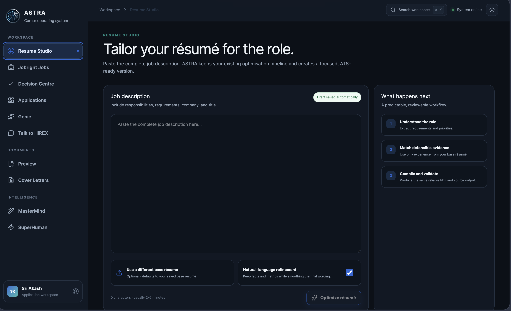

# ASTRA for macOS

<p align="center">
  
</p>

ASTRA is a local career operating system for tailoring LaTeX résumés, creating cover letters, reviewing Jobright opportunities, tracking applications, and preparing job-application answers. It runs locally on macOS and serves its UI at `http://127.0.0.1:8000`.

## Current capabilities

- Resume Studio with ATS-oriented LaTeX optimization and PDF compilation
- PDF résumé library stored in `~/Desktop/ASTRA Resumes`
- Cover letters passed through the SuperHuman writing style and saved to `~/Desktop/ASTRA Cover Letters`
- Talk to HIREX answers grounded in the selected résumé and job description
- Jobright import with role, education, duplicate, and prior-application filtering
- Internet Jobs discovery across public Greenhouse, Ashby and Lever employer feeds, with optional Adzuna and USAJOBS coverage and Bay Area/California priority ranking
- Application Decision Centre with explainable matching, eligibility evidence, document checks, safe preparation, corrections, comparison, packages, timelines, analytics, and backups
- Agent Operations workspace with human review, persistent checkpoints, editable eligibility profile, PDF repair, backup restore, interview kits, follow-up drafts, and an SQLite audit trail
- Application tracker for recruiter calls, interviews, follow-ups, offers, and rejections
- Single-instance macOS launcher fixed to port 8000
- Light and dark appearance with a React 19 interface

Automatic job submission is disabled by default. Agent preparation stops before submission.

## Technology

- Python, FastAPI and Uvicorn
- React 19 and TypeScript
- Vite and Tailwind CSS
- TanStack Query
- Radix UI
- Motion
- LaTeX and `pdflatex`
- PyInstaller for the macOS application bundle

## Project structure

```text
ASTRA/
├── backend/
│   ├── api/                  FastAPI routes and workflow services
│   ├── core/                 configuration, compiler and security helpers
│   ├── tests/                backend regression tests
│   └── tools/                local audit utilities
├── frontend-modern/          React and TypeScript source
├── frontend/app/             compiled production web application
├── frontend/                 legacy compatibility pages and static assets
├── data/samples/             local LaTeX starter documents
├── build_astra.sh            macOS application builder
├── main.py                   desktop and API entry point
└── requirements-*.txt        split dependency profiles
```

Personal application records, generated résumés, cover letters, cached job descriptions, logs, backups, and `.env` files are intentionally excluded from Git.

## Local development

### Backend

```bash
python3 -m venv .venv
source .venv/bin/activate
pip install -r requirements-core.txt
pip install -r requirements-dev.txt
python main.py
```

### Frontend

```bash
cd frontend-modern
npm install
npm run dev
```

Create the production frontend with:

```bash
npm run typecheck
npm run build
```

The Vite build writes the application into `frontend/app` for the Python server and macOS bundle.

## Configuration

Create a local `.env` file. It is ignored by Git.

```dotenv
OPENAI_API_KEY=your_key
DEFAULT_MODEL=gpt-5.4-nano
ASTRA_HOST=127.0.0.1
ASTRA_PORT=8000
# Optional nationwide aggregators
ADZUNA_APP_ID=your_adzuna_app_id
ADZUNA_APP_KEY=your_adzuna_app_key
USAJOBS_EMAIL=your_email
USAJOBS_API_KEY=your_usajobs_key
```

Additional applicant and integration settings can be supplied through environment variables or the local application profile. Do not commit private keys or candidate data.

## Tests

```bash
PYTHONPATH=. pytest backend/tests -q
cd frontend-modern
npm run typecheck
npm run build
npm run test:e2e
```

## Build the macOS app

Install the build dependencies, then run:

```bash
pip install -r requirements-build.txt
./build_astra.sh
```

The resulting bundle is created at `dist/ASTRA.app`. Copy it to `/Applications` and launch it normally. Clicking the Dock icon again reopens the existing instance rather than starting another port.

## Data safety

ASTRA keeps runtime data locally. Before deduplication or large scans, create a backup from the Decision Centre. Job applications and follow-up messages are never submitted or sent automatically without user confirmation.

## Author

Sri Akash Kadali
